<h1 align="center">HateD</h1>

<p align="center">
  <strong>For people who hate dating apps.</strong><br>
  No swiping and no feeds. One match a week, chosen by what you both actually care about.
</p>

<p align="center">
  <a href="https://misogare.github.io/Hated/"><strong>Try the demo in your browser →</strong></a><br>
  <sub>Sign in with the address it fills in and the code <strong>123456</strong>. No email is sent.</sub>
</p>

<p align="center">
  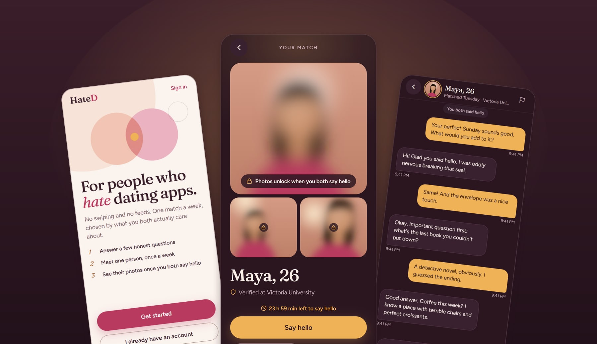
</p>

## Sam's first week

Sam has deleted three dating apps this year. The swiping, the forty
half-finished conversations, the feeling of being one card in someone else's
deck. HateD works the other way round: you say what you're like and what
matters to you, and once a week you meet one person, chosen for both of you.
This is Sam's first week.

### 1. Real people, and only real people

It starts with an email address, a university one. HateD only opens to
verified university and government addresses, so everyone Sam could meet has
done the same. There's no password to make up: a six-digit code arrives, and
no match ever sees the address.

<p align="center">
  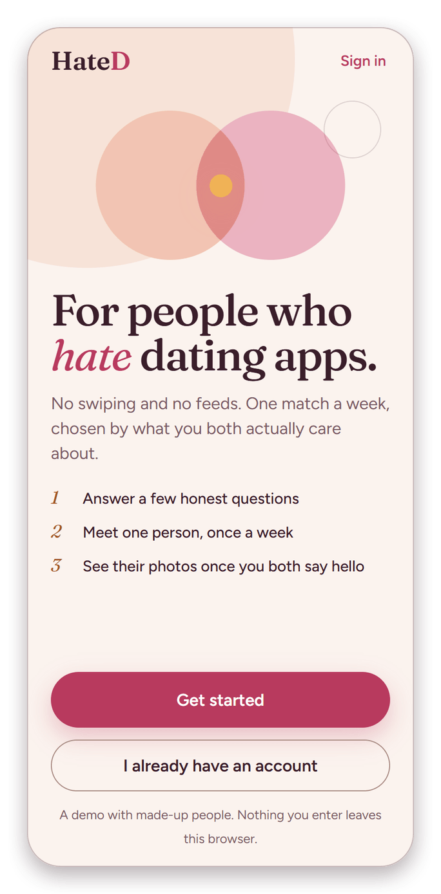
  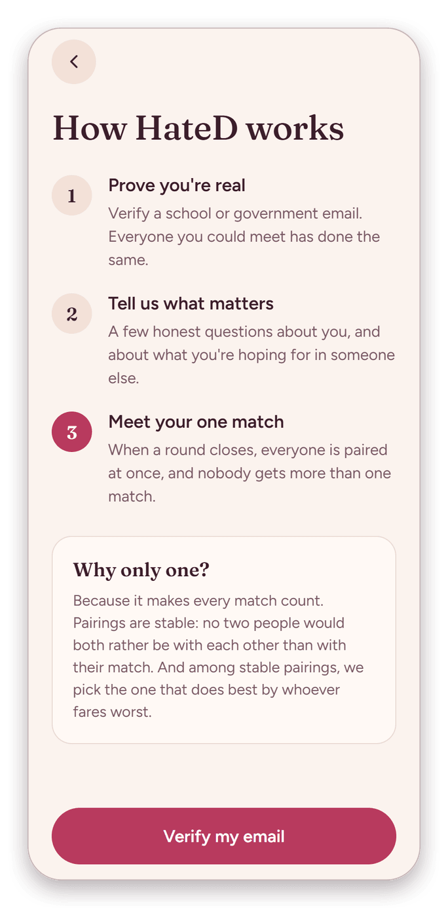
  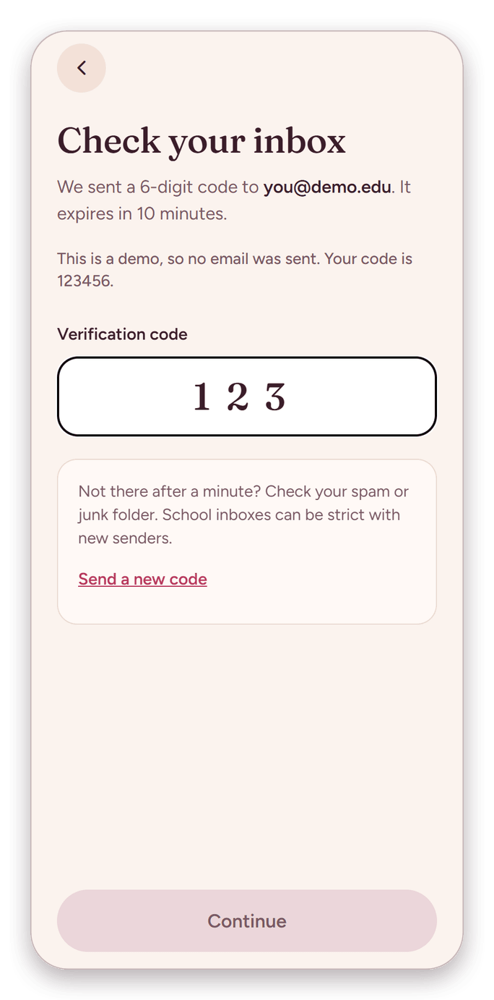
</p>

### 2. A few honest questions

Then five questions about Sam, one at a time, on sliders rather than
checkboxes: how much shared values shape the day, how social, how driven, how
much humor leads, how open to new things. Any of them can be skipped. Then the
other side of it: for each of those, what Sam hopes for in someone, and how
much it matters. "Don't mind" leaves a trait out of matching altogether.

<p align="center">
  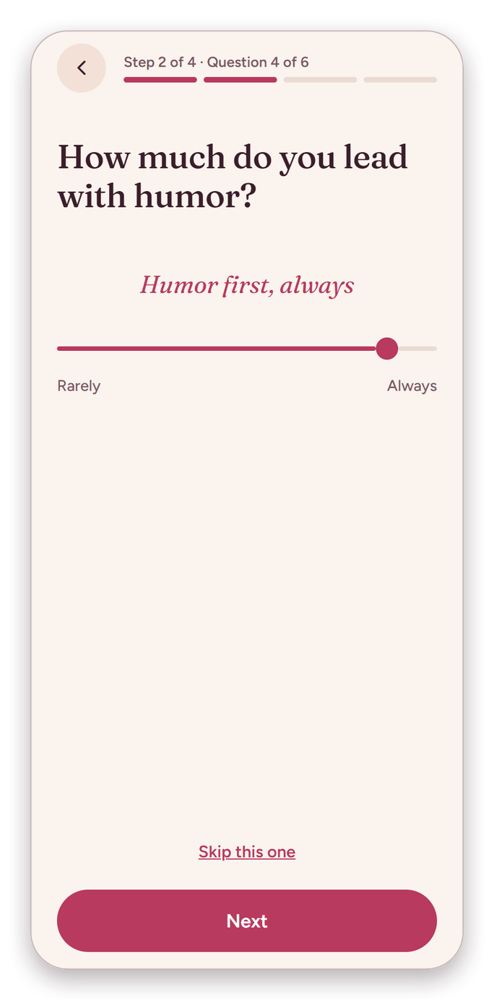
  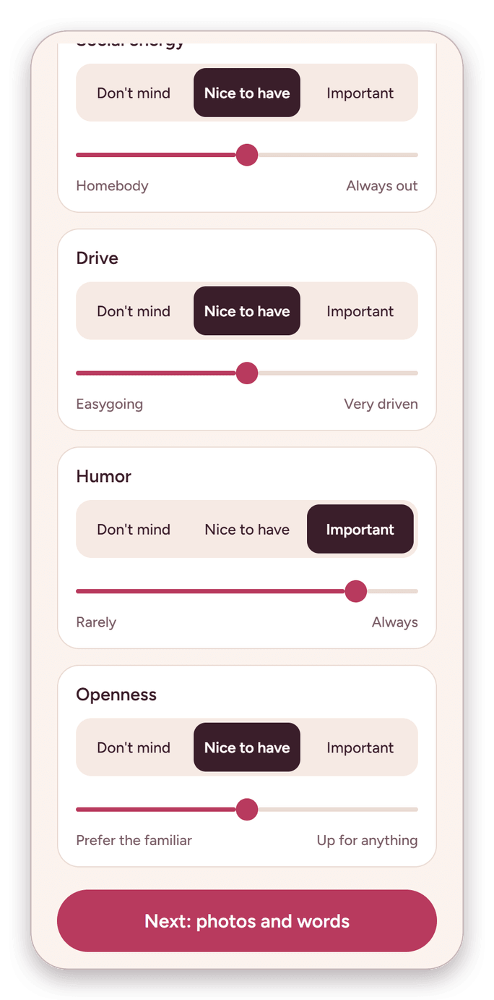
</p>

### 3. Photos that stay blurred until you both say hello

Two to six photos, a line in Sam's own words and two prompts to answer. A
match reads all of it before deciding, but sees the photos only as a blur
until both of them have said hello, and "See them as your match will" shows
exactly that. Each photo is re-encoded when it's uploaded, which leaves
everything hidden in the file behind, location included.

<p align="center">
  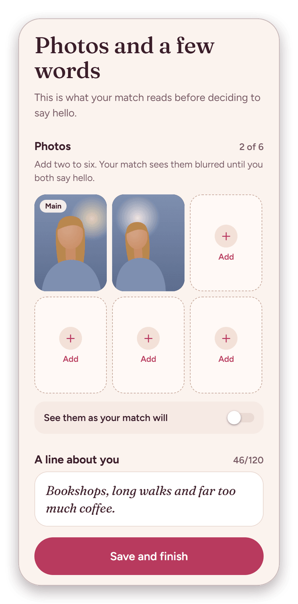
  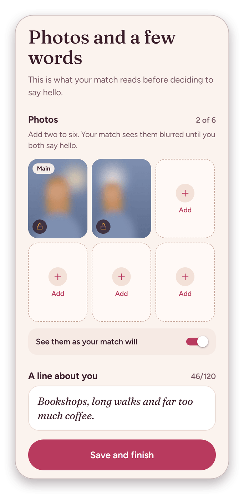
</p>

### 4. The candle burns down

Home is a candle that burns down over the week. When it goes out, on Sunday
at 8 pm, the round closes: everyone taking part is matched at once, nobody gets
more than one match, and everyone finds out at the same moment. Sitting a
round out is one switch. (The demo can't ask you to wait a week, so it has a
button that skips ahead to Sunday.)

<p align="center">
  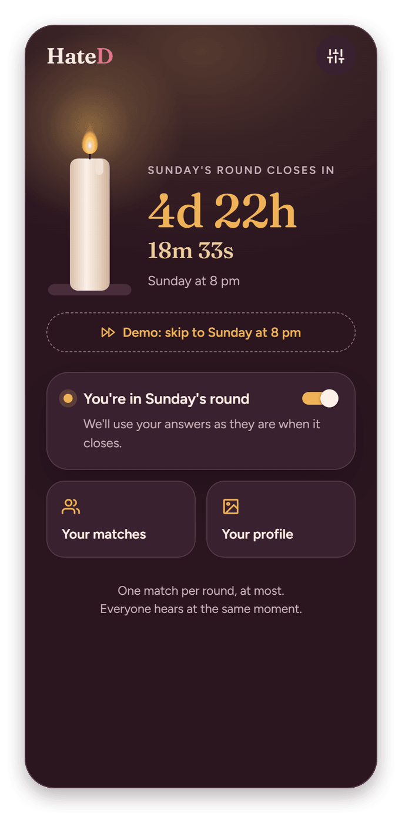
  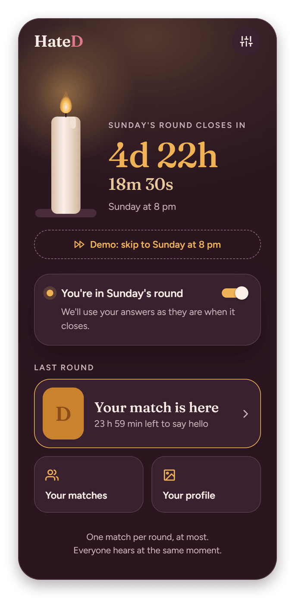
</p>

### 5. The envelope

Sam's match arrives sealed. Breaking the seal opens Maya's profile: her line,
her answers to the prompts, what her questionnaire says about her, and why
the two of them fit. Her photos stay blurred. There's nothing to swipe, only
"Say hello" or "Not for me".

<p align="center">
  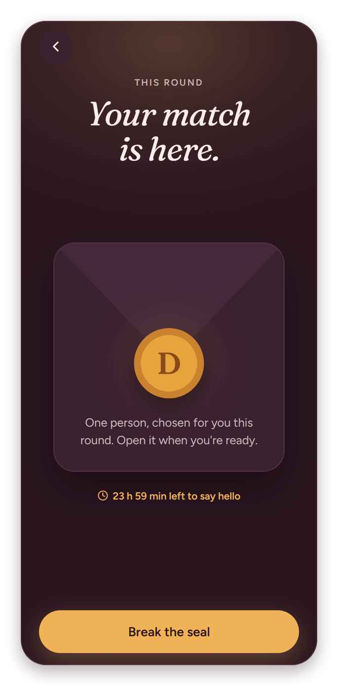
  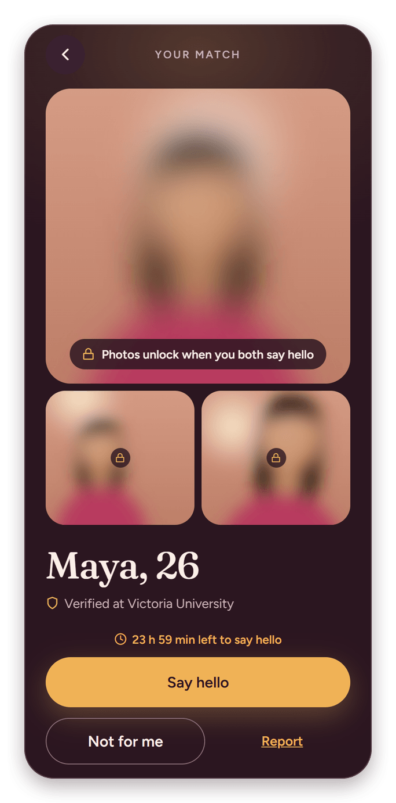
  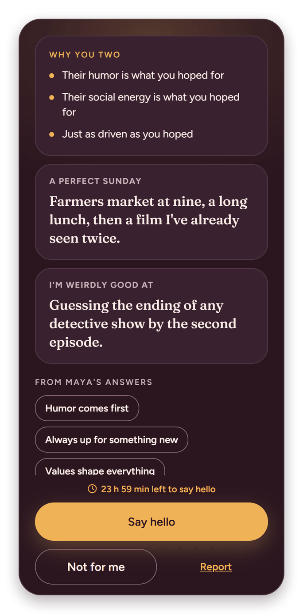
</p>

### 6. Twenty-four hours, then the moment

From the moment the round is published, the two of them have 24 hours to say
hello. Sam says it and can put the phone down; the countdown shows how long
Maya still has. If the time runs out before both have said it, the match closes
quietly, with the same words on both sides, so nobody ever learns who said
hello and who didn't.

Maya says hello back. Both phones move at the same moment: the two circles
meet, the photos come into focus, and the conversation opens.

<p align="center">
  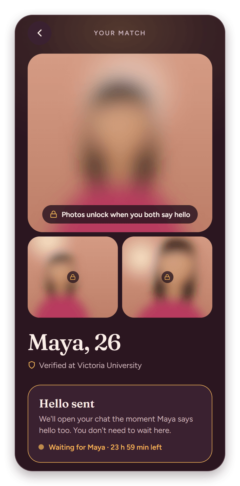
  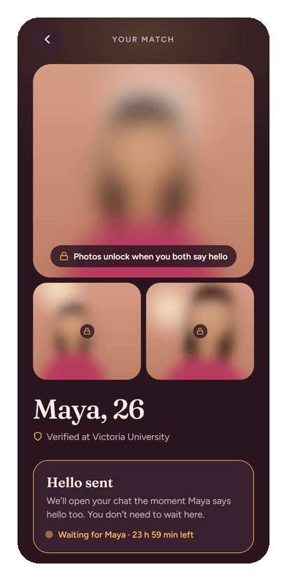
</p>

### 7. Not sure how to start?

An empty conversation suggests a few ways in, drawn from Maya's prompts and
from what the two of them share. One tap puts it in the message box, and then
it's just two people talking.

<p align="center">
  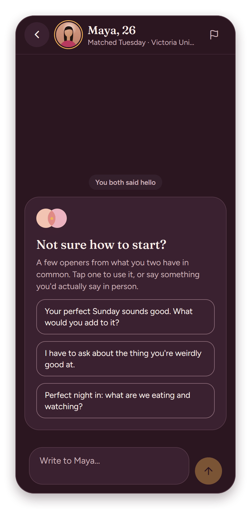
  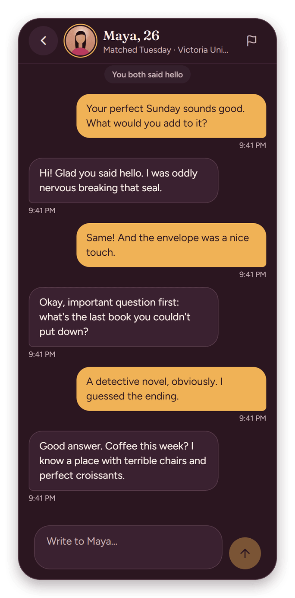
</p>

### 8. Every week after

Every round's match stays in one list, newest first, with the last message and
anything unread. In settings Sam can change any answer, choose which
notifications to get, sit out rounds, download a copy of everything HateD
holds, or delete the account and everything in it.

<p align="center">
  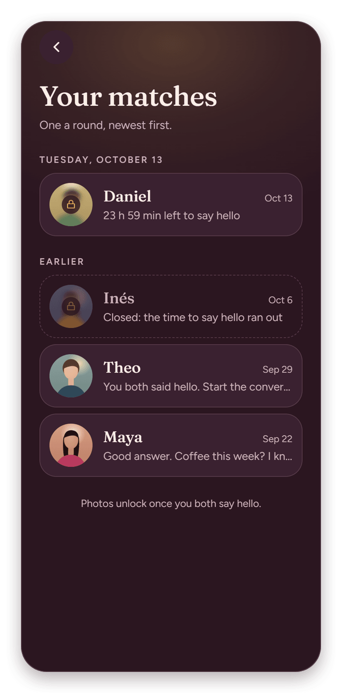
  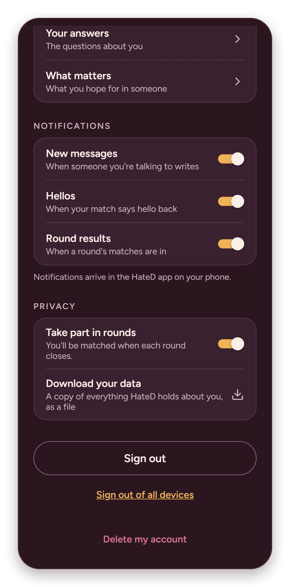
</p>

## How the matching works

A round is a stable matching, chosen to be fair. The engine is
[`packages/core`](packages/core), pure TypeScript with no I/O, in four steps:

1. **Ranking.** Everyone ranks everyone they could meet by their own answers:
   how alike the two of them are, and how well the other fits what this
   person hoped for. The two directions are allowed to disagree, which is what
   leaves room for the last step.
2. **Two sides.** Stable matching needs two sides, and real people don't come
   in two tidy groups. An orientation-aware split puts people who could match
   on opposite sides, so nobody is left out for who they are or who they're
   open to meeting.
3. **A stable matching.** Gale–Shapley pairs everyone so that no two people
   would both rather be with each other than with the match they got.
4. **The fairest one.** There are usually many stable matchings, and plain
   Gale–Shapley returns the one that's best for one side and worst for the
   other. HateD moves through the lattice of stable matchings by rotations
   and picks the one where the person who does worst does as well as possible
   (`min-regret`). Every candidate is checked to be stable before it is
   scored.

## How it's built

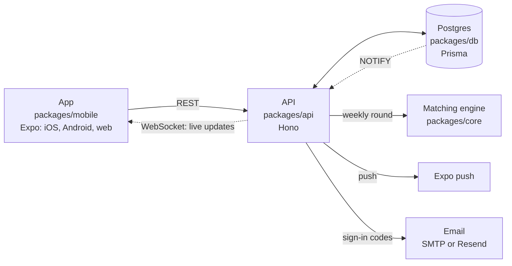

| Package | What it is |
| --- | --- |
| [`packages/core`](packages/core) | The matching engine: ranking, orientation-aware sides, Gale–Shapley, and the fairness search. |
| [`packages/db`](packages/db) | Everything that touches Postgres: sign-in, profiles, photos, rounds, the chat, live events, reports, and the data export. |
| [`packages/api`](packages/api) | The HTTP and WebSocket API the app talks to, which also runs the weekly round. |
| [`packages/mobile`](packages/mobile) | The app for iOS, Android and the web, with Expo Router, and the browser demo. |

The db, api and mobile packages each have a README with the details; the
engine explains itself in its source.

**Privacy, by default.** The server decides on every request which photos a
person may see. Photos lose their metadata when they're uploaded. Push
notifications never carry a message's text. A pass or a report ends a match
without telling the other person why, and a match that closes unanswered reads
the same to both people. Anyone can download everything HateD holds about them,
or delete it all, from settings.

## Run it yourself

You need Node 22 (see `.nvmrc`) and Docker.

```bash
npm install
docker compose up -d                               # Postgres
cp packages/db/.env.example packages/db/.env
npm run db:migrate                                 # create the tables
npm run seed -w @hated/db                          # the institutions and the questionnaire
npm run seed:demo                                  # 24 made-up members to be matched with
npm run api                                        # the API, on port 3000
npm run mobile                                     # the app: scan the QR code with Expo Go
```

With no email provider configured, the API prints each sign-in code in its
terminal, so you can sign in with any address at `demo.example.edu`, the demo
members' included. Rounds run on their own on Sundays at 8 pm (Melbourne time,
unless you change it); `npm run round -- --status PUBLISHED` runs one now. `npm run web -w @hated/mobile` opens the app in a browser instead.

To check everything:

```bash
npm test             # db's integration tests need TEST_DATABASE_URL in packages/db/.env
npm run typecheck
npm run lint -w @hated/mobile
```

## The demo

[The demo](https://misogare.github.io/Hated/) is the real app, built with
`EXPO_PUBLIC_DEMO=1`. Instead of calling the API, it talks to a stand-in that
runs in your browser ([`packages/mobile/src/demo`](packages/mobile/src/demo)),
with eight made-up people and painted portraits, never photos of real people.
They play their part: one says hello back while you wait, one has already
said it, one never does, and they answer in the chat. Sign in with any
school-style address (one is filled in for you) and the one-time code
`123456`: no email is sent, and your demo account stays in your browser.
`npm run demo` serves it locally, with no API or database.

Every push to `main` builds the demo and publishes it to GitHub Pages
([`.github/workflows/pages.yml`](.github/workflows/pages.yml)).

## License

[MIT](LICENSE)
